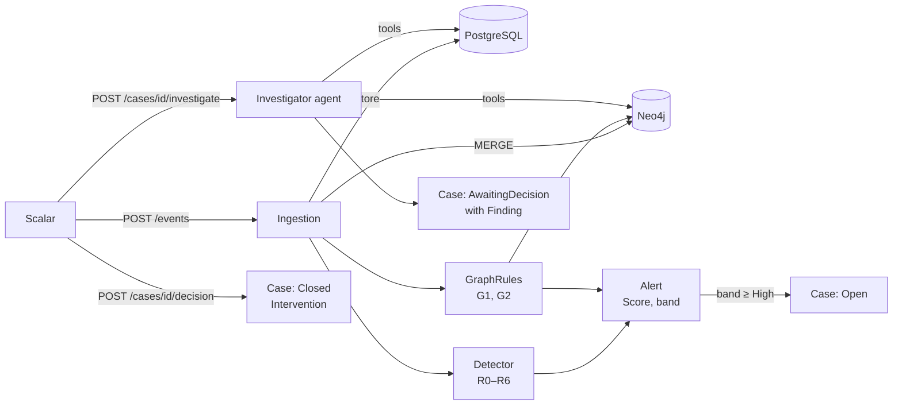

# Architecture

One page on how Vigil's parts fit together. The decisions behind them are in [adr/](adr/); ADR-0017 explains why the design is this small.

## The flow of one event

1. **Ingestion** ([Events/Ingestion.cs](../src/Vigil.Api/Events/Ingestion.cs)) stores the event, copies it into Neo4j, then asks two questions: which of the Account's own Rules did this event trigger (`Detector`), and which graph Rules (`GraphRules`)?
2. **The Alert** ([Alert.cs](../src/Vigil.Domain/Detection/Alert.cs)) collects the hits. An Account has one open Alert; each Rule counts once; the Score is the sum of the points and sets the band. An Alert quiet for more than 7 days in event time closes, and the next hit starts a new one.
3. **A Case** opens the first time the Alert reaches `openCaseAt` (High) in [rules.json](../config/rules.json).
4. **The Investigator** runs only when you call `POST /cases/{id}/investigate`. It writes a Finding onto the Case.
5. **The decision** closes the Case and its Alert, records an Intervention for the portal, and for ConfirmedFraud marks the Account in the graph so G2 can find it.

## Modules

| Project | What it holds | Depends on |
|---|---|---|
| `Vigil.Domain` | Records shared by everything: `PortalEvent`, `RuleSet`, `RuleHit`, `Alert`, Case status, `Neighbourhood` | nothing |
| `Vigil.Detection` | `Detector` with `SequenceMatcher` (R1–R6) and `FirstSighting` (R0). Pure functions: no database, no clock | Domain |
| `Vigil.Graph` | `GraphProjector` (MERGE each event), `GraphRules` (G1, G2), `GraphNeighbourhood` (who shares what) | Domain, Neo4j driver |
| `Vigil.Agents` | `Investigator`, its three tools, `Finding`, the Fake and Azure OpenAI chat clients, token logging | Domain, Microsoft Agent Framework |
| `Vigil.Api` | Endpoints, `Ingestion`, `AccountData` (what the tools read), EF Core `VigilDbContext` and its one migration | all of the above |
| `Vigil.AppHost` | Starts Postgres, Neo4j and the API with Aspire | Api |

## Data

**PostgreSQL** has three tables:

| Table | One row per | Notes |
|---|---|---|
| `events` | Portal Event | Attributes as `jsonb`. Indexed on Account and time, the path every Rule reads. |
| `alerts` | Alert | Hits as `jsonb`; Score and band are recomputed whenever a hit is added |
| `cases` | Case | Unique `AlertId`. The Finding (`jsonb`), tokens, decision and Intervention are columns |

**Neo4j** holds the graph: `(:Holder)-[:OWNS]->(:Account)`, and each Account linked to the identifiers its events carried: `USED_DEVICE`, `SEEN_FROM` (IP), `HAS_EMAIL`, `HAS_PHONE`, `PAYS_TO` (bank account), `LIVES_AT` (postcode). Only devices, emails, phones and bank accounts link Accounts in the Rules; IPs and postcodes are there to look at. A Confirmed Fraud Account has `confirmedFraud: true`. [graph-primer.md](graph-primer.md) explains the Cypher.

## The Rules

| Rule | Kind | Points | Hits when the new event… |
|---|---|---|---|
| R0 | First sighting | 10 | uses a device or country the Account never used before (never on its first event) |
| R1 | Sequence | 30 | is an MFA enrolment within 60 min of a password reset |
| R2 | Sequence | 20 | is an email or phone change within 24h of a password reset |
| R3 | Sequence | 30 | is a bank change within 72h of an email, phone or address change |
| R4 | Sequence | 40 | is a sale or transfer within 7d of a bank change |
| R5 | Sequence | 30 | is a bank change within 48h of registration |
| R6 | Sequence | 30 | is a sale or transfer within 14d of registration |
| G1 | Graph | 30 | pays out to a bank account another Holder's Account pays out to |
| G2 | Graph | 25 | uses a device, email, phone or bank account that a Confirmed Fraud Account uses |

Bands: Medium from 30, High from 60, Critical from 90. Time is always the event's `occurredAt`, never when it arrived.

## The Investigator

[Investigator.cs](../src/Vigil.Agents/Investigation/Investigator.cs) is the whole agent:

1. Read the Account's timeline, so the brief can show the flagged events by number.
2. Build the agent: `chat.AsAIAgent(name, instructions, tools)`. The instructions are [config/prompts/investigator.md](../config/prompts/investigator.md).
3. Run it: `agent.RunAsync<Finding>(brief)`. The framework asks the model for JSON in the `Finding` shape, runs any tool the model asks for, sends the result back, and parses the final reply.

The tools ([InvestigatorTools.cs](../src/Vigil.Agents/Investigation/InvestigatorTools.cs)) are plain methods with a `[Description]`: `GetTimeline(days)`, `GetLinkedAccounts()` and `GetUsualBehaviour()`. They are bound to the Case's Account, so the model cannot ask about anyone else. Every event they return starts with its number (`#3`), and the Finding cites those numbers.

The chat client is chosen by `Llm:Provider` ([LlmRegistration.cs](../src/Vigil.Agents/Llm/LlmRegistration.cs)): `Fake` (free, scripted: one tool call, then a fixed Finding) or `AzureOpenAI`. Every call is logged with its tokens and estimated cost, and traced in the Aspire dashboard.

## What is deliberately missing

No PII masking, no Reviewer agent, no durable workflow, no background queue or daily budget, no evaluation, no re-scoring of other Accounts when a link appears, no locking between concurrent requests. [industrialisation.md](industrialisation.md) says what to add back, in order, for real use.
