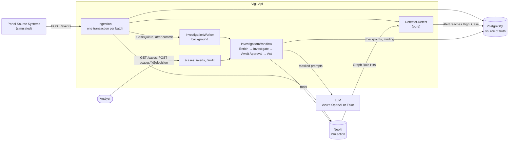
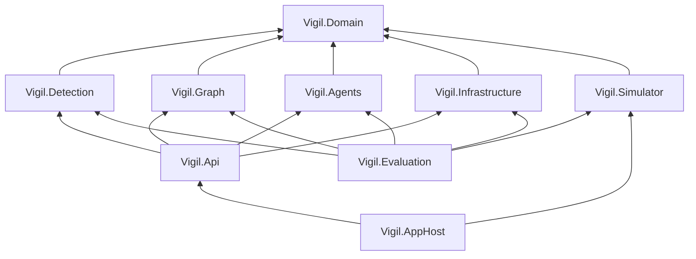
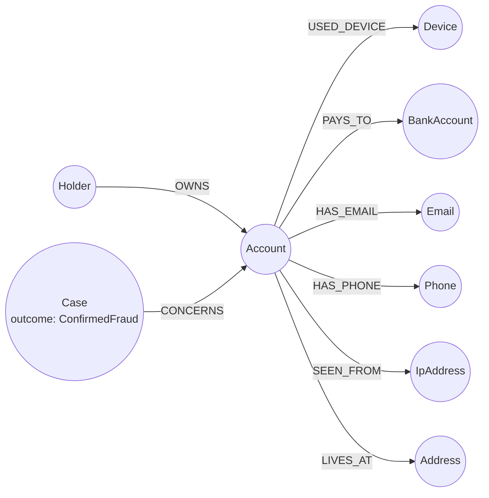
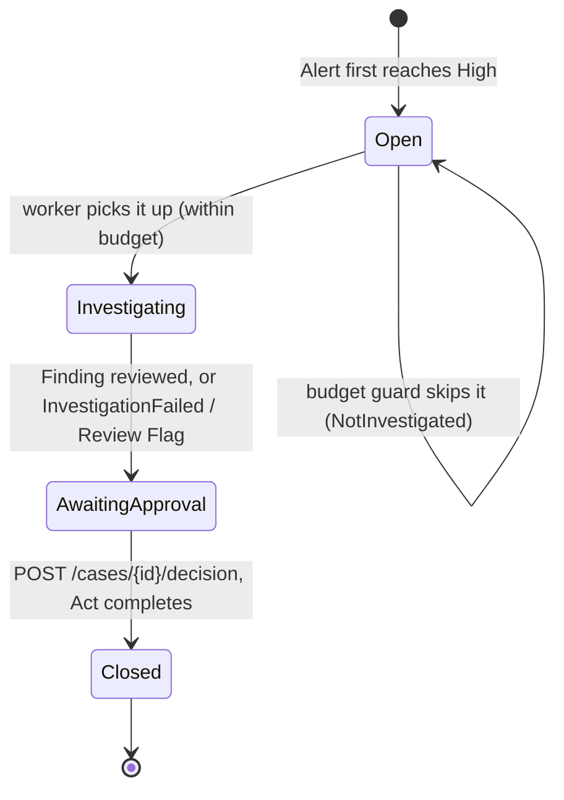
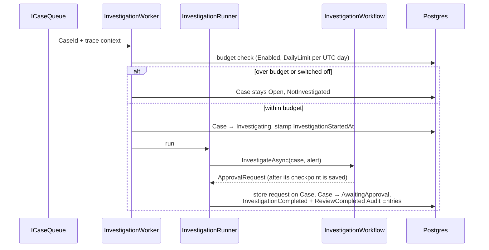
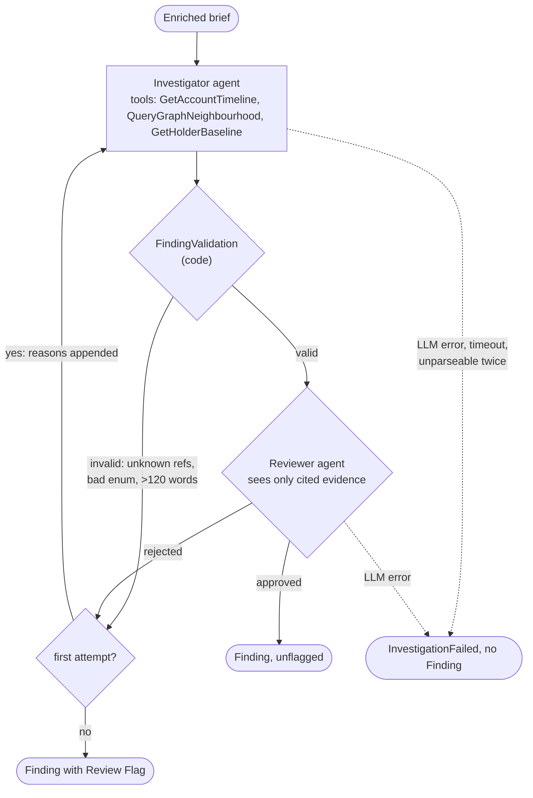
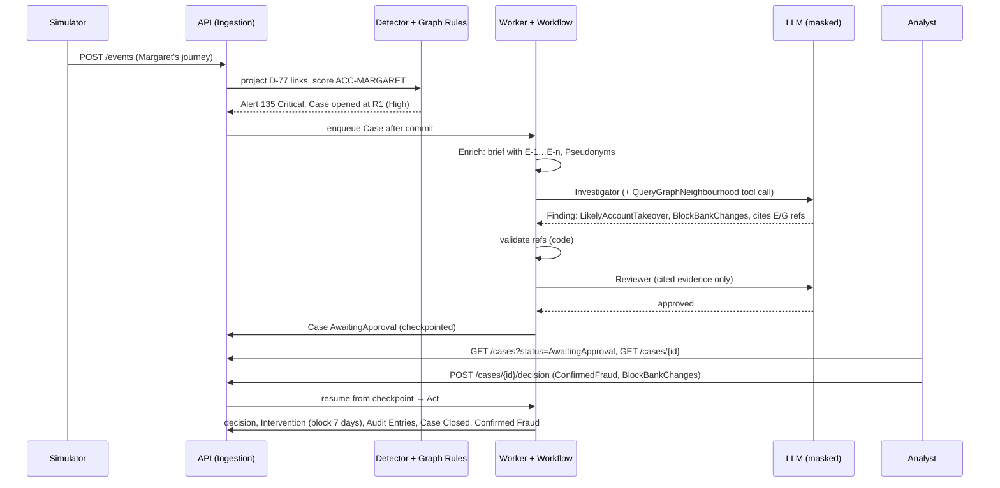
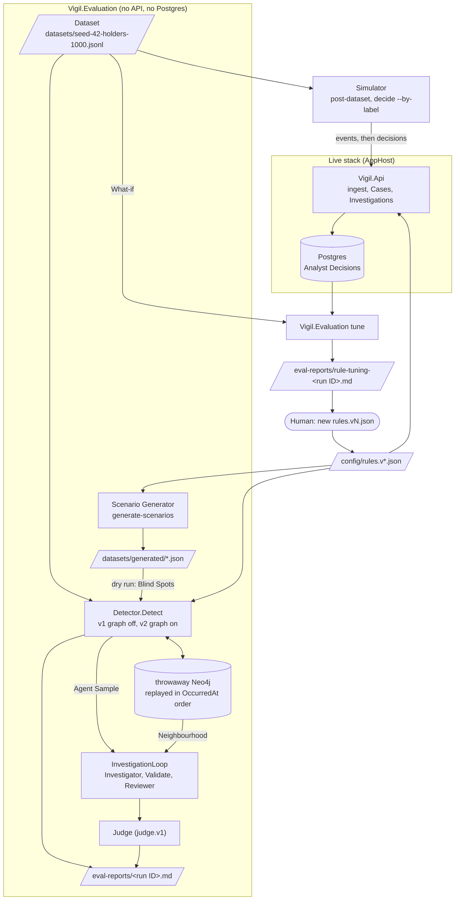

# Architecture

How Vigil is built and how its parts work together. It covers the running system as it stands at the end of Stage 4:
- **Ingestion and detection:** the rules engine and the knowledge graph.
- **The Investigation:** the AI agents and the human approval they wait for.
- **Evaluation and feedback:** the loop that measures the rules and agents and suggests rule changes.

Domain terms (Portal Event, Rule Hit, Alert, Case, Finding and so on) are defined in [GLOSSARY.md](../GLOSSARY.md). Each design choice has an ADR in [adr/](adr/), cited inline. [user-guide.md](user-guide.md) has the commands, [runbook.md](runbook.md) the recovery steps, and [industrialisation.md](industrialisation.md) the production target.

## Contents

1. [The system in one picture](#the-system-in-one-picture)
2. [Components](#components)
3. [Data model](#data-model)
4. [Ingestion and detection](#ingestion-and-detection)
5. [The knowledge graph](#the-knowledge-graph)
6. [Investigation](#investigation)
7. [Analyst Decision and Act](#analyst-decision-and-act)
8. [Margaret's case end to end](#margarets-case-end-to-end)
9. [Evaluation and feedback loop](#evaluation-and-feedback-loop)
10. [Cross-cutting concerns](#cross-cutting-concerns)
11. [Known limits](#known-limits)

## The system in one picture

Cheap, deterministic rules score every Portal Event as it arrives. The knowledge graph adds what one Account's history cannot show: links to other Accounts and to known fraud. Only an Account whose Alert reaches High gets a Case. The Case is investigated by two AI agents working on masked data, and then waits for a named analyst to decide. Every step is recorded, and analysts' decisions come back as suggested rule changes that a human approves.



## Components

### Projects

| Project | Responsibility |
|---|---|
| `Vigil.Domain` | Records and enums shared by everything: Portal Event, Rule Set, Rule Hit, Alert, Risk Band, Case status, Confirmed Fraud, Dataset and Label, and the `Vigil` telemetry source. No logic beyond parsing and validation. |
| `Vigil.Detection` | The rules engine. One pure entry point, `Detector.Detect(timeline, ruleSet, stored, graphHits)`, with no database and no clock. Inside it: `SequenceMatcher` (two-step Rules in a Window), `FirstSighting` (R0) and `RiskEpisodes` (groups hits into Alerts and scores them). |
| `Vigil.Graph` | Neo4j. `GraphProjector` MERGEs Portal Events and Confirmed Frauds into the Projection. `GraphRules` runs the Graph Rules G1–G3 as one-hop Cypher queries and finds Neighbours. `GraphNeighbourhood` answers the Investigator's graph tool. |
| `Vigil.Agents` | The Investigation:<br/>• `Investigator` and its three tools<br/>• `Reviewer`<br/>• `FindingValidation` and `InvestigationLoop`<br/>• `PseudonymMasker` and `MaskedEvidence`<br/>• `EvidenceRefTable`<br/>• `InvestigationWorkflow` and its executors<br/>• the shared LLM wiring in `Llm/`: provider switch, Fake, token logging.<br/>It depends only on `Vigil.Domain`; everything it reads comes through `IInvestigationSource`. |
| `Vigil.Infrastructure` | EF Core over Postgres: the event, alert, case, Confirmed Fraud and audit stores, the workflow checkpoint store and the migrations. |
| `Vigil.Api` | The host:<br/>• ingestion<br/>• the HTTP endpoints<br/>• the Case queue and `InvestigationWorker`<br/>• `InvestigationRunner`, which drives the workflow<br/>• `ActStep`<br/>• the `InvestigationSource` over Postgres and Neo4j<br/>• the `rebuild-graph` command. |
| `Vigil.Simulator` | Posts Scenario files, generates seeded labelled Datasets from Personas, posts a Dataset (`post-dataset`), and plays the Stand-in Analyst (`decide --by-label`). |
| `Vigil.Evaluation` | Offline measurement:<br/>• rules with the graph off and on<br/>• the Agent Sample, with the Judge<br/>• Blind Spots from Generated Scenarios<br/>• the Scenario Generator (`generate-scenarios`)<br/>• the Rule-Tuning Report (`tune`)<br/>• single-Scenario dry runs (`scenario`). |
| `Vigil.ServiceDefaults` | OpenTelemetry, health checks and HTTP resilience, shared by every service. |
| `Vigil.AppHost` | Aspire: starts Postgres, Neo4j, the API, and the explicit-start `simulator` and `rebuild-graph` resources, and hosts the dashboard. |

`Vigil.Detection`, `Vigil.Graph` and `Vigil.Agents` are the core modules. They are kept small and dependency-light so they can be read and reviewed on their own.

### Dependencies



The core modules do not reference each other or the infrastructure. Detection takes graph hits as an argument rather than querying Neo4j, and the agents read through `IInvestigationSource` rather than EF Core. The API wires real implementations into those seams, and evaluation wires in-memory ones. That is how one engine serves both the live path and evaluation.

### Runtime resources (AppHost)

| Resource | What it is | Starts |
|---|---|---|
| `postgres` / `vigil` | PostgreSQL container, data in volume `vigil-postgres-data` | Automatically |
| `neo4j` | `neo4j:5-community`, data in volume `vigil-neo4j-data`, fixed ports 7474 (Browser) and 7687 (bolt), generated password in user-secrets | Automatically |
| `api` | `Vigil.Api`: migrates the database and creates the Neo4j constraints on start | After both stores |
| `rebuild-graph` | The API binary with `rebuild-graph`: wipes and re-projects Neo4j from Postgres (ADR-0015) | Explicit start only |
| `simulator` | Posts every Scenario in `scenarios/` | Explicit start only |

## Data model

### Postgres (source of truth)

| Table | Holds | Written by |
|---|---|---|
| `events` | Append-only Portal Events. `EventId` is the primary key, which makes ingestion idempotent. Indexed on `(AccountId, OccurredAt)`, with type-specific details in an `Attributes` jsonb column (ADR-0010). | Ingestion |
| `alerts`, `rule_hits` | One Alert per Risk Episode, with its Score, Risk Band and Rules Version. Rule Hits are append-only, each with its evidence EventIds (`uuid[]`), trigger time and explanation (ADR-0013). | Ingestion |
| `cases` | One per Alert that reached High:<br/>• status, priority fields and the `NotInvestigated` and `InvestigationFailed` flags<br/>• the masked Finding, Review Flag, Pseudonym map and Evidence Refs<br/>• token usage, Prompt Version and the Investigation's trace id | Ingestion opens it; the worker and runner fill it |
| `workflow_checkpoints` | One row per workflow superstep, keyed by the Case as the MAF session. The payload is `json`, not `jsonb` (ADR-0005). | The workflow |
| `analyst_decisions` | One per Case, keyed by CaseId: outcome, action, analyst, notes, time. | Act |
| `interventions` | The instruction for the portal to enforce, such as BlockBankChanges until a date or ContactHolder. | Act |
| `confirmed_frauds` | One per Account: decided time and Source (Seed or Analyst). | `POST /accounts/{id}/confirmed-fraud`, Act |
| `audit_entries` | Append-only record of each step: actor, model, Prompt Version, Rules Version, evidence, tokens. | Runner, Act |

### Neo4j (the Projection)



- **Linking Identifiers:** Device, BankAccount, Email and Phone. Only these count as links between Accounts. IP addresses and postal Addresses are projected for exploration, but households, offices and mobile carriers share them innocently, so they never link.
- **Relationship properties:** each relationship carries `firstSeen` (the earliest OccurredAt) and `firstEventId` (the event that set it), which Graph Rules cite as evidence.
- **Disposable:** the graph can be wiped and rebuilt from Postgres at any time (ADR-0015). [graph-primer.md](graph-primer.md) explains the Cypher.

## Ingestion and detection

### One request, one transaction

`POST /events` takes a batch of Portal Events. `Ingestion.IngestAsync` processes it in one Postgres transaction:

```mermaid
sequenceDiagram
    participant Client
    participant Ing as Ingestion
    participant Pg as Postgres
    participant Neo as Neo4j
    participant Det as Detector
    participant Q as ICaseQueue

    Client->>Ing: POST /events (batch)
    Ing->>Pg: BEGIN; advisory lock per Account (sorted)
    Ing->>Pg: append events (idempotent on EventId)
    Ing->>Neo: MERGE the whole batch into the Projection
    Ing->>Neo: find Neighbours (Accounts sharing a Linking Identifier)
    Ing->>Pg: lock Neighbours (sorted)
    loop each batch Account, then each Neighbour
        Ing->>Pg: load timeline and stored Alerts
        Ing->>Neo: Graph Rule Hits for the Account
        Ing->>Det: Detect(timeline, ruleSet, stored, graphHits)
        Det-->>Ing: stored Alerts, extended, plus any new ones
        Ing->>Pg: append new Rule Hits; open a Case if an Alert first reaches High
    end
    Ing->>Pg: COMMIT
    Ing->>Q: enqueue each opened Case with the request's trace context
    Ing-->>Client: 200 (ingested / already ingested per event)
```

The order of these steps is deliberate:
- **Advisory locks taken in sorted order.** Two batches for the same Account are serialised, and they cannot deadlock on the batch's own Accounts.
- **Projecting before the commit.** A Neo4j failure fails the request and rolls back Postgres. The client's retry is safe, because appending is idempotent on `EventId` and MERGE is idempotent on node keys (ADR-0015).
- **Neighbours are re-scored in the same request.** When a new Account links to a shared bank account, the Accounts already on it gain a G1 hit at once, not on their next event.
- **Cases are queued only after the commit.** A rolled-back batch never starts an Investigation (ADR-0004).
- **Transient failures replay the whole transaction.** Npgsql's execution strategy retries the whole transaction, including a deadlock between two batches that link to each other's Neighbours. Each attempt rebuilds its own list of opened Cases.

### The Detector

`Detector.Detect` is a pure function: the same timeline, rules, stored Alerts and graph hits always give the same Alerts. Three kinds of Rule produce candidate Rule Hits:

| Kind | Rules | How it matches |
|---|---|---|
| Sequence | R1–R6 | Step B is the event being evaluated. Step A is the latest earlier event matching the Rule's first step, at most the Window before it (inclusive). Each step may list alternative event types. |
| First Sighting | R0 | An event whose device or country has not appeared earlier on the Account. The Account's first event never counts, and a new device with a new country is one First Sighting. |
| Graph | G1–G3 | Computed by `Vigil.Graph` and passed in. The Detector only places them. |

`RiskEpisodes` then merges all candidates in trigger-time order into Alerts (ADR-0013):
- **Episodes:** a hit within `riskPeriodDays` (7) of the previous hit joins its Risk Episode; a longer gap opens a new Alert.
- **Scoring:** each Rule counts once per episode, so the Score is the sum of distinct Rules and never decreases.
- **Bands:** the Score maps to a Risk Band using the thresholds in the rules file: Medium 30, High 60, Critical 90.
- **Stored Alerts are only extended:** existing hits are never rewritten, so the evidence behind an Alert an analyst has seen never changes.

Time is always event time (`OccurredAt`), never the wall clock. That is why replaying 90 simulated days in seconds gives the same Alerts as live ingestion.

### Rules as versioned config

The rules live in `config/rules.v1.json` (sequence and first-sighting) and `config/rules.v2.json` (v1 plus Graph Rules). The API loads the file named by `Rules:Path`, which is v2, at startup and fails fast if it is malformed (ADR-0002). Every Alert stores the Rules Version that opened it. `GET /rules` shows what is live.

### Cases

The first time an Alert reaches High, ingestion opens one Case for it with status Open:
- **Queue order:** `GET /cases` orders Cases by Risk Band, then Score, then time opened.
- **One Case per Alert:** reaching Critical later raises the Case's priority. It opens no second Case and starts no second Investigation.



## The knowledge graph

### Projection

`GraphProjector` MERGEs each event into the graph:
- **Always:** Holder OWNS Account, plus the event's device and IP.
- **From attributes:** `NewEmail`, `NewPhone`, `NewBankAccountHash` and `NewPostcode` give the Email, Phone, BankAccount and Address links.
- **Earliest wins:** a relationship keeps its earliest `firstSeen`, with the lower EventId breaking an exact tie. Projection is therefore order-independent, and a rebuild gives the same graph as live ingestion.
- **No duplicate nodes:** uniqueness constraints on every node key are created when the API starts, so concurrent MERGEs cannot duplicate a node.

A Confirmed Fraud is projected as `(:Case {outcome: 'ConfirmedFraud'})-[:CONCERNS]->(:Account)`. Recording one re-scores the fraud Account's Neighbours, each of which may now have G2.

### Graph Rules

Each Graph Rule is one short Cypher query asking about one Account (ADR-0014):

| Rule | Points | Matches |
|---|---|---|
| G1 Shared bank account | 30 | The Account pays out to a BankAccount that an Account owned by a different Holder also pays out to. |
| G2 Known-fraud proximity | 25 | One of its Linking Identifiers is also linked to a Confirmed Fraud Account. |
| G3 Ring indicator | 20 | One of its Linking Identifiers is shared by at least `accountThreshold` (3) Accounts, this one included. |

How a graph hit fits into detection:
- **Trigger time:** the `firstSeen` of the link that completed the pattern, so the hit lands in the right Risk Episode even when it is discovered later.
- **Evidence:** the linking events on every Account involved.
- **Reading the graph as it is now:** this is safe live, because each batch is projected before it is scored. Evaluation gets the same effect by replaying the Dataset into a throwaway Neo4j in time order.

### Rebuild

`rebuild-graph` restores the Projection when Neo4j data is lost or the projection model changes:
1. Wipe Neo4j and drop every constraint.
2. Recreate the constraints.
3. Re-project every Portal Event, then every Confirmed Fraud, from Postgres.

Alerts are not re-scored, because they are append-only. Run it with ingestion stopped.

## Investigation

### From queue to workflow



`ICaseQueue` is a bounded in-process `Channel<T>` (capacity 1000) behind an interface, so it can be swapped for Service Bus (ADR-0004). Postgres, not the channel, is the durable record. On startup, before the server accepts requests, the worker re-runs every Case left Open or Investigating, except those the budget guard deliberately skipped. The worker takes one Case at a time, which keeps the daily count free of races. That design assumes a single API instance.

### The workflow

`InvestigationWorkflow` is a Microsoft Agent Framework (MAF) workflow of four steps (ADR-0005):

| Step | Kind | Does |
|---|---|---|
| Enrich | Code (`EnrichExecutor`) | Builds the masked brief: the Alert's Score, Risk Band and Rule Hits, each citing the `E-n` Evidence Refs of the events behind it, with those events listed. |
| Investigate | Code hosting two agents (`InvestigateExecutor` → `InvestigationLoop`) | Investigator, then code validation, then Reviewer, with one retry. Always returns an outcome. |
| Await Approval | MAF `RequestPort` | Emits an `ApprovalRequest` (masked Finding, flags, Pseudonym map, Evidence Refs with EventIds, token usage, Prompt Version) and pauses for an `AnalystDecision`. |
| Act | Code (`IActStep`, implemented by `ActStep` in the API) | Records the decision, Intervention and Audit Entries, and closes the Case. |

Every superstep is checkpointed to `workflow_checkpoints` through `PostgresCheckpointStore`, so a Case waiting for a decision survives an API restart. The first run watches the stream with `blockOnPendingRequest: false`, so it returns as soon as the approval request is emitted and its checkpoint is saved.

### Inside Investigate



- **The Investigator** (`vigil-investigator`, `investigator.v1`) is a MAF `ChatClientAgent`. It has three tools bound in code to the Case's Account, so the model cannot query another Holder whatever it is told (ADR-0007):

  | Tool | Returns |
  |---|---|
  | `GetAccountTimeline(days)` | The Account's events in the last `days` days of event time, capped at 90 |
  | `QueryGraphNeighbourhood()` | The Neighbourhood: each Linking Identifier, the other Accounts on it, and whether each is Confirmed Fraud |
  | `GetHolderBaseline()` | Usual countries, devices and logins per week, from before the earliest event any Rule Hit cites |

  This is the GraphRAG step: the model retrieves relational facts and reasons over them, with no vector database.

- **The Finding** is structured output with five fields:

  | Field | Values |
  |---|---|
  | verdict | LikelyAccountTakeover, LikelyRegistrationFraud, Inconclusive or LikelyGenuine |
  | confidence | Low, Medium or High |
  | summary | At most 120 words |
  | recommendation | BlockBankChanges, ContactHolder or NoAction |
  | evidence | The Evidence Refs it cites |

- **Validation in code before review** (ADR-0006) checks that the Finding:
  - uses only the enum values above;
  - keeps the summary within the word limit;
  - cites at least one ref, and only refs this Investigation actually issued.

  These checks are certain and free in code, so no model is paid to make them.

- **The Reviewer** (`vigil-reviewer`, `reviewer.v1`) has no tools. It sees the Finding and, for each cited ref, the exact masked line the Investigator was shown, and it answers `{ approved, reasons[] }`.

- **Retries:** a Finding rejected twice still reaches the analyst, marked with a Review Flag. An LLM failure is not retried, because an outage won't heal in one retry; it reaches the analyst as InvestigationFailed. Every path ends at Await Approval, so no risky Account is lost because AI was unavailable.

### Masking and Evidence Refs

No real identifier reaches the LLM (ADR-0008):
- **Per-Investigation masker.** Each Investigation has its own `PseudonymMasker`. Every identifier a tool hands over is registered and swapped for a per-Investigation Pseudonym (`ACCOUNT-1`, `DEVICE-2`) wherever its value appears, including inside Rule Hit explanations.
- **Unknown attributes.** Attributes not on an allow-list (only `Amount` is shown as it is) are masked by default.
- **No linking across Cases.** Pseudonyms are numbered per Investigation, so the same device has different Pseudonyms in different Cases, and prompts cannot be correlated.
- **Unmasking only for the analyst.** The Pseudonym map is stored with the Case. `GET /cases/{id}` shows the analyst the unmasked Finding.

`MaskedEvidence` writes every tool result. Each new event gets an `E-n` ref and each graph fact a `G-n` ref, recorded in the `EvidenceRefTable`, which is how code can check that every cited ref exists. Each ref resolves back to EventIds, so the analyst can verify every claim against the underlying events.

### The LLM behind one interface

Everything that calls a model takes an `IChatClient` (ADR-0009). `Llm:Provider` chooses between two:
- **`AzureOpenAI`:** through the v1 endpoint, with the key from the AppHost's secret parameter.
- **`Fake`:** a scripted provider and the Development default. It plays an Investigator that makes one graph tool call and cites real refs, and a Reviewer that approves. For evaluation it also plays the Judge and the Scenario Generator. Demos, tests and CI cost nothing and need no key.

`TokenLoggingChatClient` wraps whichever is chosen and logs model, tokens and estimated £ on every call. The wiring lives in `Vigil.Agents/Llm`, shared by the API and evaluation. Provider settings are checked at startup, not on the first call.

## Analyst Decision and Act

`POST /cases/{id}/decision` with `{ outcome, action, analystId, notes }`:

1. **Check the status.** Anything other than AwaitingApproval gets 409.
2. **Resume.** The workflow is rebuilt and resumed from the Case's latest checkpoint. The re-emitted approval request keeps its RequestId across a restart, and is answered with the decision. No model is called on resume.
3. **Act runs in one transaction.** It:
   - records the Analyst Decision (one per Case, enforced by the key);
   - records the Intervention: BlockBankChanges until a date (`Intervention:BlockBankChangesDays`, default 7) or ContactHolder;
   - writes the DecisionRecorded and ActionTaken Audit Entries;
   - closes the Case.
4. **Record a Confirmed Fraud.** A ConfirmedFraud outcome also records a Confirmed Fraud (Source = Analyst) in the same transaction. That projects it into the graph and re-scores the Account's Neighbours, so G2 lifts Accounts that share its identifiers.

If Act fails, nothing is kept and the Case stays AwaitingApproval, so the decision can be posted again. Two concurrent decisions cannot both win: the loser gets 409.

Vigil records the Intervention for the portal to enforce. It does not block later Portal Events itself.

`GET /cases/{id}/audit` returns the trail:

| Entry | Records |
|---|---|
| InvestigationCompleted, ReviewCompleted | Actor, model, Prompt Version, Rules Version, cited refs with EventIds, tokens |
| DecisionRecorded, ActionTaken | The analyst |

## Margaret's case end to end

The worked example from PROJECT.md Section 3.1, as the system runs it with `rules.v2.json`.

The setup, from the Scenarios: Margaret has months of logins from her laptop in the UK. Device D-77 has already been used on three other Accounts (Derek, Priya and Lena), and Priya is seeded as Confirmed Fraud. A fraudster on D-77 in Romania then works through Margaret's account:

| Event (event time) | New Rule Hits | Score | Band |
|---|---|---|---|
| `PasswordReset` from D-77, RO | R0 First Sighting (+10); G2 D-77 shared with Confirmed Fraud Priya (+25); G3 D-77 now on 4 Accounts (+20) | 55 | Medium |
| `MfaEnrolled`, 4 min later | R1 reset → MFA within 1h (+30) | 85 | **High: Case opened** |
| `EmailChanged`, 10 min after reset | R2 reset → contact change within 24h (+20) | 105 | Critical |
| `BankDetailsChanged`, next day | R3 contact change → bank change within 72h (+30) | 135 | Critical |

The graph hits trigger at the reset, because that is when Margaret's link to D-77 formed, so they land in the same Risk Episode. The Alert reached High before any bank change, which is what the early-detection rate measures.



In the dashboard's Traces view, the ingest request is one trace. It runs from `POST /events` through `graph.project`, `detect` and `graph.rules`, to `investigate case`, then the Investigator with its `chat` and `execute_tool` spans, then the Reviewer. The decision is its own trace, linked back to the Investigation.

Mr Patel's house move (an address change, then a phone change, on his usual device) matches no Rule, so he has no Alert, no Case and no LLM call.

## Evaluation and feedback loop

Evaluation measures the rules and the agents offline. A red-team agent looks for fraud the rules miss. Analyst Decisions on live Cases come back as suggested rule changes, which a human approves. Nothing in the loop changes the rules by itself (ADR-0012).



### Datasets

`Vigil.Simulator generate --seed 42 --holders 1000` writes a Dataset of labelled Accounts as JSON lines. The same seed and size always give a byte-identical file. Each Account comes from a Persona (PROJECT.md Section 10.1), and its Label (Persona plus fraud kind, or genuine) is read only by evaluation, never sent to the API:

| Genuine Personas | Fraud Personas |
|---|---|
| Quiet holder, House mover, New phone, Active trader, Travelling holder | ATO fraudster, Registration fraudster, Fraud ring, Slow-burn fraudster |

### Measuring the rules and the agents

`dotnet run --project src/Vigil.Evaluation` is one command that produces one report, with no API or Postgres:

1. **Rules.** It scores the Dataset with `Detector.Detect` twice, writing both side by side:
   - **Graph off (v1).**
   - **Graph on (v2).** It first replays every event into a throwaway Neo4j container in OccurredAt order, collecting graph hits for each event's Account and its Neighbours, as ingestion does.

   An Account is Flagged when any of its Alerts reached High. The report gives:
   - detection rate (flagged fraud ÷ all fraud)
   - false-positive rate (flagged genuine ÷ all genuine)
   - early-detection rate (ATO flagged before its first bank change ÷ all ATO)
   - per-Rule precision
   - a per-Persona breakdown against Section 10.1's expectations
2. **Agents.** From the v2 scores it draws an Agent Sample: 20 Flagged Accounts taken in turn from each Persona, plus Near-misses (genuine Accounts that peaked at Medium), never more than a quarter of the sample, with the seed fixing the draw (ADR-0016). Each one runs through the same `InvestigationLoop` the API runs:
   - **Events:** its tools read a `DatasetInvestigationSource` in place of the event store.
   - **Graph:** they read the throwaway Neo4j in place of the Projection.
   - **Cut-off:** the source stops at the moment the Case would have opened, so the agents never see an event from the future.
3. **Code before LLM.** These are measured by code:
   - **Evidence Grounding**, on each first attempt, before validation rejects unknown refs; after that check it would always be 100%.
   - **Verdict Agreement** between each Finding's verdict and the Account's Label.
   - **Reviewer rejection rate** and **Review Flag rate**.
   - **Cost and latency**: tokens, £ and seconds per Investigation.
4. **Judge.** Only reasoning quality needs an LLM. The evaluation-only Judge (`judge.v1`) scores each Finding 1 to 5, with a reason, on four criteria: grounded claims, sound reasoning, proportionate recommendation and clarity. It is shown every evidence line the Investigator saw, cited or not. Its cost is reported apart from the Investigations'.
5. **Blind Spots.** Every Generated Scenario in `datasets/generated/` is dry-run against v2, and each fraud one that never reaches High is listed.

The report header names the run ID, seed, Rules Versions, Prompt Versions (`investigator.v1+reviewer.v1`, `judge.v1`), provider and model, so two runs can be compared knowing what changed. `--llm Fake`, the default, is free, and its agent numbers are marked not meaningful. `--llm AzureOpenAI` spends only on the Agent Sample, never the whole Dataset.

### Looking for what the rules miss

`generate-scenarios` asks the Scenario Generator agent for fraud the rules would miss. It is a red team: it is shown the rules file, the hand-written Scenarios and the shapes already kept. Each Scenario in its reply must pass three checks before it is kept:
- It parses under the same strict Scenario parser the simulator uses.
- It carries a Label.
- Its signature (event types in order, gaps rounded to the hour) is unlike every Scenario already kept.

Kept ones are committed to `datasets/generated/` for review. The generator only writes Scenarios. Deciding which Blind Spots deserve a new Rule is a human's job.

### From decisions back to the rules

The Rule-Tuning Report learns from Analyst Decisions on live Cases, so the loop goes through the running API:

1. **Post the Dataset.** `Vigil.Simulator post-dataset` posts a Dataset's events to `POST /events` without their Labels, in OccurredAt order across all Accounts, so the graph builds as it would live. Accounts that reach High open Cases, and the worker investigates them.
2. **Decide every Case.** `Vigil.Simulator decide --by-label` is the Stand-in Analyst. It decides each Case in AwaitingApproval from its Account's Label, through `POST /cases/{id}/decision`, so Act runs exactly as for a human decision. The genuine Travelling holder Persona reaches High, so the decisions include false positives as well as fraud.
3. **Build the report.** `Vigil.Evaluation tune` reads Analyst Decision → Case → Alert → Rule Hits from Postgres. A Rule's precision is the share of decided Cases containing it that were ConfirmedFraud. A Rule below 50% precision, with at least 5 decisions, gets a suggestion: halve its points, to the nearest 5, with a tie rounding up. Each suggestion has a What-if: detection is re-run over the Dataset with that one change, showing detection, false-positive and early-detection rates before and after.
4. **A human decides.** If they accept a suggestion, they write a new rules file, re-run the evaluation to compare, and deploy it. Every Alert scored from then on records the new Rules Version (ADR-0002).

The What-if is the point of the report: a noisy Rule can still be what carries fraud over the line. Lowering R2 quiets the Travelling holder, but it also delays every takeover without graph evidence past its email change: in the first real report, early detection falls from 9/9 to 0. Margaret herself stays High, because G2 and G3 add 45 points. Whether that trade is worth it is a business judgement, which is why the system never makes it (ADR-0012).

The report can only see Rules that reached a Case. Fraud the rules miss entirely never reaches an analyst, which is what Blind Spots and the detection rate are for.

## Cross-cutting concerns

### Configuration

| Setting | Where | Default |
|---|---|---|
| `Rules:Path` | `src/Vigil.Api/appsettings.json` | `config/rules.v2.json` |
| `Llm:Provider`, `Endpoint`, `Deployment`, `ApiKey`, `InputPricePer1kTokens`, `OutputPricePer1kTokens` | appsettings; the key comes from the AppHost secret `azure-openai-key` | `Fake` in Development |
| `Investigation:Enabled`, `Investigation:DailyLimit` | appsettings | `true`, 20 per UTC day |
| `Intervention:BlockBankChangesDays` | appsettings | 7 |
| Prompts | `config/prompts/*.v1.md`, embedded in `Vigil.Agents`; the file name is the Prompt Version | |

### Observability

Every service calls `AddServiceDefaults()`, which wires OpenTelemetry to the Aspire dashboard locally (ADR-0011).

**Spans:**
- `graph.project`, `graph.neighbours`, `detect` (one per scored Account) and `graph.rules`.
- `investigate case`, which joins the ingest request's trace through the context queued with the Case. It contains the workflow, `invoke_agent Investigator` with its `chat` and `execute_tool` spans, and `invoke_agent Reviewer`.
- `decide case`, a separate trace linked to the Investigation.

**Metrics:** `vigil.llm.tokens` (by agent and direction), `vigil.llm.cost` (£ per Investigation) and `vigil.investigation.duration`.

### Security, privacy and audit

- **PII minimisation:** every string sent to an LLM is masked per Investigation.
- **The analyst decides:** agents only recommend. Act runs only after a named analyst's decision, and the approval step cannot be skipped because it is a step in the workflow, not a convention.
- **Audit trail:** Audit Entries are append-only and record model, Prompt Version, Rules Version, evidence and tokens.
- **Rules are versioned:** stored Rule Hits are never re-scored under a newer version.
- **Secrets:** Neo4j, Postgres and Azure OpenAI secrets live in the AppHost's user-secrets. There is no analyst authentication yet; see [industrialisation.md](industrialisation.md).

### Failure handling

| Failure | Behaviour |
|---|---|
| Neo4j down during ingest | The request fails and Postgres rolls back. The client retries. |
| Neo4j data lost | `rebuild-graph` from Postgres. |
| Transient Postgres error or deadlock | The execution strategy replays the whole transaction. |
| API crash with Cases queued | Startup re-runs Open and Investigating Cases from Postgres. |
| API restart while awaiting a decision | The checkpoint in Postgres. The decision resumes the workflow. |
| LLM down or slow | The Investigation fails cleanly. The Case reaches the analyst as InvestigationFailed. Rules and Alerts are unaffected. |
| Daily LLM budget reached | Cases wait Open, marked NotInvestigated. |
| Act fails | Nothing is written. The Case stays AwaitingApproval and the decision can be re-posted. |

### Testing

| Level | What | How |
|---|---|---|
| Unit | Windows, scoring, Risk Episodes, masking, validation, sampling, tuning arithmetic | xUnit (`dotnet test` runs on Microsoft.Testing.Platform) |
| Integration | Event store, ingestion, Cypher queries, decision reader | Testcontainers Postgres and Neo4j |
| Workflow | Approve, reject, reviewer-reject, failure and restart paths | Scripted or Fake `IChatClient` |
| Evaluation | Metrics on hand-labelled data and the seed-42 Dataset | Evaluation tests |

No test calls a real LLM. CI runs the same suite on every push.

## Known limits

- **The slow-burn fraudster is a known miss.** It spaces each step just beyond its Rule's Window, and no fixed Window catches it. A per-Holder anomaly score is the planned answer ([industrialisation.md](industrialisation.md)).
- **Graph Rules are one hop** (ADR-0014). G3 counts Accounts on one shared identifier, so a chain of different identifiers is not a Ring, and G2 does not look two hops out.
- **Single API instance.** The in-process queue and the one-Case-at-a-time worker assume it (ADR-0004).
- **Dual write.** Postgres and Neo4j are not one transaction. A commit failure after the Neo4j write can leave stray links until the client retries or the graph is rebuilt (ADR-0015).
- **Self-preference.** The Judge runs on the same model as the Investigator, so it may favour that model's style (ADR-0016).
