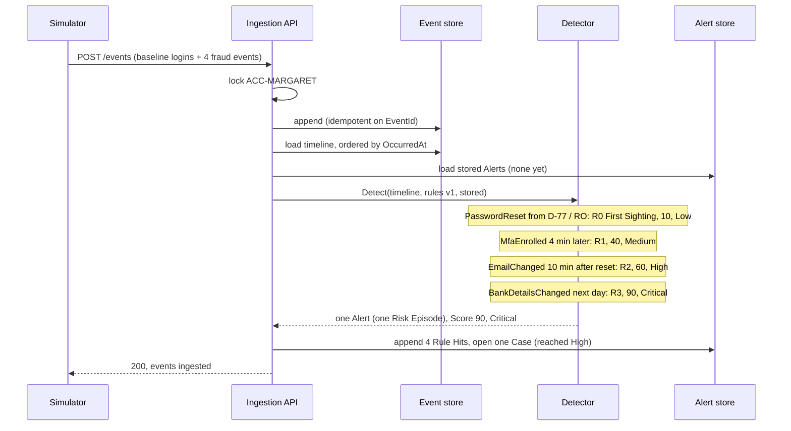

# Architecture

Vigil as it stands at the end of Stage 1: a deterministic rules engine scores each Account as its Portal Events arrive, and the same engine scores labelled Datasets offline. Graph rules (Stage 2) and agents (Stage 3) come later; PROJECT.md Section 4 has the target design.

## Components

| Component | Responsibility |
|---|---|
| `Vigil.Domain` | Records shared by everything: Portal Event, Rule Set, Rule Hit, Alert, Risk Band, Case status, Dataset and Label. |
| `Vigil.Detection` | The rules engine. One pure entry point, `Detector.Detect(timeline, ruleSet, stored)`: no database, no clock. Inside are the sequence matcher, the First Sighting check (R0) and Risk Episode assembly. |
| `Vigil.Infrastructure` | EF Core stores: append-only events, Alerts with their Rule Hits, and Cases. |
| `Vigil.Api` | Ingests batches, runs detection inside the ingest transaction, and serves `/alerts`, `/cases`, `/rules` and Account timelines. |
| `Vigil.Simulator` | Posts the Scenario files in `scenarios/` (Margaret and Mr Patel) to the API, and (`generate`) writes a seeded, labelled Dataset to a file. Labels never go to the API. |
| `Vigil.Evaluation` | Loads a Dataset, runs `Detector.Detect` per Account in memory, and writes a markdown report. Its `scenario` command dry-runs one Scenario step by step against any rules file. No API, no database, no LLM. |
| `Vigil.AppHost` | Starts PostgreSQL, Neo4j, the API and the simulator, and hosts the tracing dashboard. |

## Data flow

**Live path.** `POST /events` takes a batch. In one transaction, the API locks each Account in the batch (a Postgres advisory lock, taken in sorted order so batches cannot deadlock), appends the events idempotently on `EventId`, then for each Account loads its whole timeline and its stored Alerts and calls `Detector.Detect`. The detector only ever extends stored Alerts (ADR-0013), so the alert store appends the new Rule Hits, updates Score and Risk Band, and opens a Case the first time an Alert reaches High. A failure rolls back events and Alerts together.

**Offline path.** `Vigil.Simulator generate` writes a Dataset of labelled Accounts as JSON lines. `Vigil.Evaluation` reads it, calls the same `Detector.Detect` with no stored Alerts, and compares each Account's Alerts with its Label. Because detection works in event time, never wall-clock time, replaying 90 simulated days in memory gives the same Alerts as live ingestion would. `Vigil.Evaluation scenario <file>` uses the same path for one Scenario: after each scripted step it runs `Detector.Detect` on everything that had happened by then, showing the Score and Risk Band an analyst would have seen at that moment.

Both paths read the rules from the same versioned file (ADR-0002), and every Alert and report records its Rules Version.

## Margaret's case through Stage 1

PROJECT.md Section 3.1: months of logins from Margaret's laptop in the UK, then a fraudster on device D-77 in Romania resets her password, enrols MFA and changes her email within ten minutes, and changes her bank details the next day. The simulator posts the whole journey as one batch; the Score's progress below is what the Rule Hits' trigger times record.

The Alert reached High at the email change, before the bank change, which is what the early-detection rate measures. Reaching Critical later raises the Case's priority but opens no second Case. Posting the same batch again changes nothing: the events are already stored, and the detector finds no new hits.

Mr Patel's house move (address change, then phone change, on his usual device) matches no Rule, so he has no Alert at all.

## Evaluation

`dotnet run --project src/Vigil.Evaluation` scores the seed-42, 1,000-holder Dataset and writes `eval-reports/<run ID>.md` with:

- **Detection rate**: flagged fraud ÷ all fraud.
- **False-positive rate**: flagged genuine ÷ all genuine.
- **Per-rule precision**: hits on fraud Accounts ÷ all hits, per Rule.
- **Early-detection rate**: ATO fraud flagged before its first BankDetailsChanged ÷ all ATO fraud.
- A per-Persona breakdown beside PROJECT.md Section 10.1's expected outcome.

An Account is flagged when any of its Alerts reached High or above. Two misses are expected at this stage: the slow-burn fraudster spaces each step just beyond its Rule's Window, and each fraud-ring Account alone reaches only Medium until Stage 2's graph rules link them.
