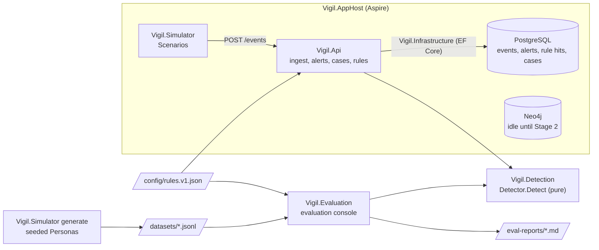
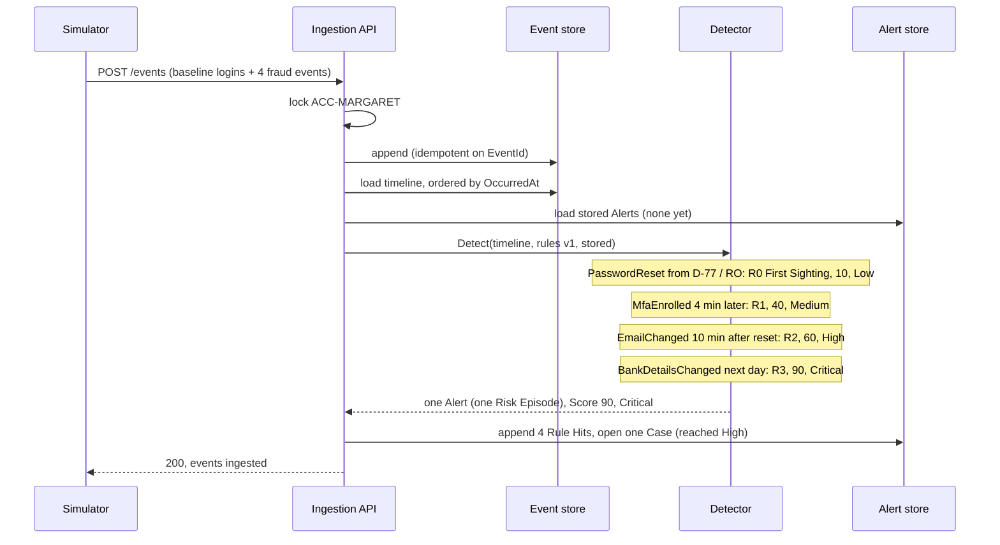

# Architecture

How Vigil's pieces fit together. The components, data flow and Margaret's case below describe the Stage 1 core: a deterministic rules engine scores each Account as its Portal Events arrive, and the same engine scores labelled Datasets offline. Graph Rules (Stage 2) and the agents (Stage 3) are recorded in ADR-0013 to ADR-0015 and ADR-0004 to ADR-0009. The [evaluation and feedback loop](#evaluation-and-feedback-loop) (Stage 4) is at the end. PROJECT.md Section 4 has the target design, and [industrialisation.md](industrialisation.md) the production one.

## Components

| Component | Responsibility |
|---|---|
| `Vigil.Domain` | Records shared by everything: Portal Event, Rule Set, Rule Hit, Alert, Risk Band, Case status, Dataset and Label. |
| `Vigil.Detection` | The rules engine. One pure entry point, `Detector.Detect(timeline, ruleSet, stored)`: no database, no clock. Inside are the sequence matcher, the First Sighting check (R0) and Risk Episode assembly. |
| `Vigil.Infrastructure` | EF Core stores: append-only events, Alerts with their Rule Hits, and Cases. |
| `Vigil.Api` | Ingests batches, runs detection inside the ingest transaction, and serves `/alerts`, `/cases`, `/rules` and Account timelines. |
| `Vigil.Simulator` | Posts the Scenario files in `scenarios/` (Margaret and Mr Patel) to the API, and (`generate`) writes a seeded, labelled Dataset to a file. Labels never go to the API. |
| `Vigil.Evaluation` | Loads a Dataset, runs `Detector.Detect` per Account with the graph off and on, and writes a markdown report comparing them. With the graph on it replays the Dataset into a throwaway Neo4j container for the graph Rule Hits. Its `scenario` command dry-runs one Scenario step by step against any rules file. Since Stage 4 it also runs the agents on an Agent Sample, finds Blind Spots and builds the Rule-Tuning Report (see [Evaluation and feedback loop](#evaluation-and-feedback-loop)). It needs no API, and only `tune` reads Postgres. |
| `Vigil.AppHost` | Starts PostgreSQL, Neo4j, the API and the simulator, and hosts the tracing dashboard. |

## Data flow

**Live path.** `POST /events` takes a batch. In one transaction, the API locks each Account in the batch (a Postgres advisory lock, taken in sorted order so batches cannot deadlock), appends the events idempotently on `EventId`, then for each Account loads its whole timeline and its stored Alerts and calls `Detector.Detect`. The detector only ever extends stored Alerts (ADR-0013), so the alert store appends the new Rule Hits, updates Score and Risk Band, and opens a Case the first time an Alert reaches High. A failure rolls back events and Alerts together.

**Offline path.** `Vigil.Simulator generate` writes a Dataset of labelled Accounts as JSON lines. `Vigil.Evaluation` reads it, calls the same `Detector.Detect` with no stored Alerts, and compares each Account's Alerts with its Label. Because detection works in event time, never wall-clock time, replaying 90 simulated days in memory gives the same Alerts as live ingestion would. `Vigil.Evaluation scenario <file>` uses the same path for one Scenario: after each scripted step it runs `Detector.Detect` on everything that had happened by then, showing the Score and Risk Band an analyst would have seen at that moment.

Both paths read the rules from the same versioned file (ADR-0002), and every Alert and report records its Rules Version.

## Margaret's case through Stage 1

PROJECT.md Section 3.1: months of logins from Margaret's laptop in the UK, then a fraudster on device D-77 in Romania resets her password, enrols MFA and changes her email within ten minutes, and changes her bank details the next day. The simulator posts the whole journey as one batch; the Score's progress below is what the Rule Hits' trigger times record.

The Alert reached High at the email change, before the bank change, which is what the early-detection rate measures. Reaching Critical later raises the Case's priority but opens no second Case. Posting the same batch again changes nothing: the events are already stored, and the detector finds no new hits.

Mr Patel's house move (address change, then phone change, on his usual device) matches no Rule, so he has no Alert at all.

## Evaluation

`dotnet run --project src/Vigil.Evaluation` scores the seed-42, 1,000-holder Dataset twice, with the graph off (v1) and on (v2), and writes both side by side to `eval-reports/<run ID>.md`. With the graph on it replays every event into a throwaway Neo4j container in OccurredAt order, one event at a time; after each it collects graph Rule Hits for the event's Account and its Neighbours, as ingestion does. Each Account is then scored once with the hits collected for it. The report has:

- **Detection rate**: flagged fraud ÷ all fraud.
- **False-positive rate**: flagged genuine ÷ all genuine.
- **Per-rule precision**: hits on fraud Accounts ÷ all hits, per Rule.
- **Early-detection rate**: ATO fraud flagged before its first BankDetailsChanged ÷ all ATO fraud.
- A per-Persona breakdown beside PROJECT.md Section 10.1's expected outcome.

An Account is flagged when any of its Alerts reached High or above. With the graph off, each fraud-ring Account alone reaches only Medium; with it on, G1 and G3 lift all five to Critical. The slow-burn fraudster stays a known miss either way, since it spaces each step just beyond its Rule's Window. G2 has no hits, because the generated Dataset contains no Confirmed Fraud; Scenarios demonstrate it.

## Evaluation and feedback loop

Stage 4 closes the loop: evaluation measures the rules and the agents offline, a red-team agent looks for fraud the rules miss, and Analyst Decisions on live Cases come back as suggested rule changes that a human approves. Nothing in the loop changes the rules by itself (ADR-0012). [runbook.md](runbook.md) has the commands.

### Measuring the rules and the agents

`dotnet run --project src/Vigil.Evaluation` is one command that produces one report, with no API or Postgres:

1. **Rules.** It scores the Dataset twice, with the graph off (v1) and on (v2), as described in [Evaluation](#evaluation) above.
2. **Agents.** From the v2 scores it draws an Agent Sample: 20 Flagged Accounts taken in turn from each Persona, plus up to 5 Near-misses, with the seed fixing the draw (ADR-0016). Each one runs through the same `InvestigationLoop` the API runs. Its tools read a `DatasetInvestigationSource` in place of the event store, and the throwaway Neo4j the graph replay filled in place of the Projection. The source is cut off at the moment the Case would have opened, so the agents never read an event that came later.
3. **Code before LLM.** Evidence Grounding is measured on each first attempt, before the validation that rejects unknown Evidence Refs, because after that check it would always be 100%. Verdict Agreement compares each Finding's verdict with the Account's Label. The Reviewer's rejection rate, the Review Flag rate, and tokens, £ and seconds per Investigation are counted from the loop's outcome.
4. **Judge.** Only reasoning quality needs an LLM: the evaluation-only Judge (`judge.v1`) scores each Finding 1 to 5 on grounded claims, sound reasoning, proportionate recommendation and clarity, against the same masked evidence. It never runs on a live Case, so it lives in `Vigil.Evaluation`, and its cost is kept apart from the cost per Investigation.
5. **Blind Spots.** Every Generated Scenario in `datasets/generated/` is dry-run against v2, and each fraud one that never reaches High is listed as a Blind Spot.

The report header names the run ID, seed, Rules Versions, Prompt Versions (`investigator.v1+reviewer.v1`, `judge.v1`), provider and model, so two runs can be compared knowing what changed. The LLM wiring lives in `Vigil.Agents`, shared by the API and evaluation; `--llm Fake` (the default) is free and its agent numbers are marked not meaningful, while `--llm AzureOpenAI` spends only on the Agent Sample.

### Looking for what the rules miss

`generate-scenarios` asks the Scenario Generator agent, a red team that is shown the rules file and the hand-written Scenarios, for fraud the rules would miss. Its reply goes through the same strict Scenario parser the simulator uses. A Generated Scenario must carry a Label, and is kept only if its signature (event types in order, gaps rounded to the hour) is unlike every Scenario already kept. Kept ones are committed to `datasets/generated/` for review. The generator only writes Scenarios; deciding which Blind Spots deserve a new Rule is a human's job.

### From decisions back to the rules

The Rule-Tuning Report learns from Analyst Decisions on live Cases, so the loop goes through the running API:

1. `Vigil.Simulator post-dataset` posts a Dataset's events to `POST /events` without their Labels, in OccurredAt order across all Accounts, so the graph builds as it would live. Accounts that reach High open Cases, and the worker investigates them.
2. `Vigil.Simulator decide --by-label` is the Stand-in Analyst. It decides each Case in AwaitingApproval from its Account's Label, through `POST /cases/{id}/decision`, so Act runs exactly as for a human decision and a ConfirmedFraud records a Confirmed Fraud. The genuine Travelling holder Persona reaches High, so the decisions include false positives as well as fraud.
3. `Vigil.Evaluation tune` reads Analyst Decision → Case → Alert → Rule Hits from Postgres. A Rule's precision is the share of decided Cases containing it that were ConfirmedFraud. A Rule below 50% precision with at least 5 decisions gets a suggestion: halve its points, to the nearest 5. Each suggestion has a What-if: detection is re-run over the Dataset with that one change, showing detection, false-positive and early-detection rates before and after.
4. A human reads the report and, if they accept a suggestion, writes a new rules file, re-runs the evaluation to compare, and deploys it. Every Alert scored from then on records the new Rules Version (ADR-0002).

The What-if is the point of the report: a noisy Rule can still be what carries fraud over the line. Lowering R2 quiets the Travelling holder, but it also delays Margaret's takeover past her email change. Whether that trade is worth it is a business judgement, which is why the system never makes it (ADR-0012). The report can only see Rules that reached a Case; fraud the rules miss entirely never reaches an analyst, which is what Blind Spots and the detection rate are for.
